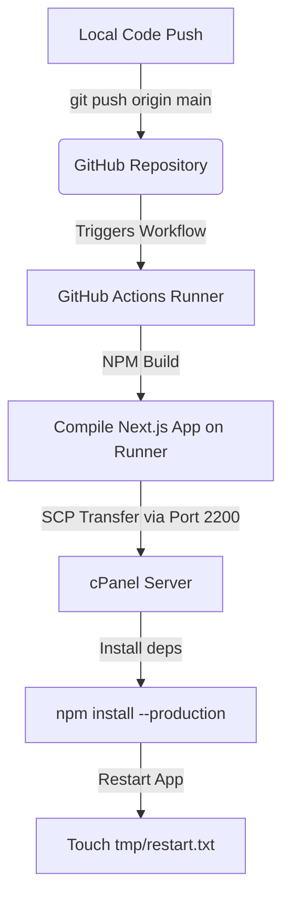

# 🍍 Swing Social Website

Swing Social is a premium, feature-rich social networking and event platform built on Next.js. It connects members through real-time communication, interactive matchmaking (card swiping), event management, and secure monetization systems.

---

## 🚀 Key Features

### 👤 Profile & Interactive Matching
*   **Tinder-like Swiping Interface:** Fully responsive card swiping to discover, like, or pass on members using smooth gestural animations (`framer-motion` & `react-tinder-card`).
*   **Dynamic Profiles:** Highly customizable member profiles containing private and public galleries, physical attributes, swing styles, and locations.
*   **Identity & Selfie Verification:** Automated profile verification using **AWS Rekognition** face matching, alongside automated safety checking via **NSFWJS** and **SightEngine**.

### 💬 Real-Time Communication
*   **WebSockets Messaging:** Instant, real-time private messaging powered by a custom **Socket.IO** server.
*   **Interactive Mailbox:** Fully functional inbox, sent folder, and trash management.
*   **Push Notifications:** System notifications and mobile/desktop alert delivery using **Firebase Cloud Messaging (FCM)**.

### 📅 Event Management & RSVP
*   **Custom Tickets & Events:** Create, edit, and search events. RSVP system with options for ticket types, quantity selection, and automated RSVP attendee lists.
*   **Ticket Scrapers:** Background scraping service to import local partner events.
*   **Digital RSVP Tickets:** Generate and email digital tickets complete with QR codes (`qrcode.react`) for on-site scanning.

### 💳 Secure Subscriptions & Monetization
*   **Multi-Gateway Integration:** Integrated support for **Stripe**, **PayPal**, and **Authorize.Net** for premium memberships, tickets, and one-off purchases.
*   **Affiliate Portal:** Integrated referral dashboard tracking affiliate application statuses, banner impressions, payment history, and automated payout execution.

---

## 🛠 Tech Stack

*   **Framework:** Next.js (App & Pages Router hybrid)
*   **Language:** TypeScript
*   **Styles & UI:** Material UI (MUI v6), Vanilla CSS, Framer Motion, react-spring
*   **Databases:** PostgreSQL (`pg`), MySQL (`mysql2`)
*   **Real-time:** Socket.IO, Pusher
*   **Image Processing & AI:** TensorFlow.js, MobileNet, NSFWJS, AWS Rekognition, Azure Blob Storage
*   **Services:** Twilio (SMS), Nodemailer / Mailgun / Postmark (Emails), Gemini API (AI text generation/rewrites)

---

## 📁 Repository Structure

```text
├── src/
│   ├── app/                # Next.js App Router (pages, APIs, layout)
│   │   ├── api/            # Serverless API endpoints (payment, events, auth, mail)
│   │   ├── marketplace/    # Marketplace feature routes
│   │   ├── messaging/      # Messaging and real-time chat views
│   │   └── whatshot/       # User-generated posts, likes, comments (social feed)
│   ├── components/         # Reusable UI components (header, footer, profile drawers)
│   ├── commonPage/         # Shared pages & layouts (Consent banners, Loaders)
│   ├── config/             # Centralized environment configuration (index.ts)
│   ├── context/            # Socket and Query provider contexts
│   ├── hooks/              # Custom React hooks (geolocation, sockets, preferences)
│   ├── lib/                # Third-party service clients (Stripe, Paypal, DB connection, Rekognition)
│   ├── pages/              # Legacy or custom page routing
│   ├── services/           # Business logic engines (Scrapers, Gemini rewriter)
│   ├── theme/              # Custom MUI design tokens and variables
│   └── utils/              # Client/Server helper utilities (crop, date format, error reporting)
├── public/                 # Static assets (icons, brand images)
├── types/                  # Global TypeScript type declarations
└── .env.example            # Environment configuration template
```

---

## ⚙️ Environment Variables Setup

Before running the application, copy `.env.example` to `.env.local` and populate it with your credentials:

```bash
cp .env.example .env.local
```

### Configuration Parameters

| Variable | Description |
| :--- | :--- |
| `DB_USER` / `DB_HOST` / `DB_PASSWORD` / `DB_NAME` | Connection details for the relational database. |
| `AWS_ACCESS_KEY_ID` / `AWS_SECRET_ACCESS_KEY` | Credentials for AWS Rekognition & S3 storage. |
| `AZURE_STORAGE_CONNECTION_STRING` | Azure Blob Storage Connection String for image uploads. |
| `STRIPE_SECRET_KEY` | Stripe secret key for payment processing. |
| `PAYPAL_CLIENT_ID` / `PAYPAL_CLIENT_SECRET` | PayPal API access keys. |
| `GOOGLE_MAPS_API_KEY` | Map visualization and location lookup API. |
| `GEMINI_API_KEY` | Gemini API key for rewriter functionalities. |
| `NEXT_PUBLIC_SIGHTENGINE_API_USER` / `_SECRET` | Image moderation credentials. |
| `FIREBASE_PROJECT_ID` / `FIREBASE_PRIVATE_KEY` | Firebase Admin SDK config for push notifications. |
| `AUTHORIZENET_API_LOGIN_ID` / `_TRANSACTION_KEY` | Authorize.Net API credentials. |

---

## 🚀 Getting Started

### 1. Install Dependencies
```bash
npm install
```

### 2. Run the Development Server
```bash
npm run dev
```

Open [http://localhost:3000](http://localhost:3000) to view the application.

### 3. Run the Websocket Server
For real-time chat, start the local websocket server:
```bash
node src/server/socket.js
```

---

## 🔒 Security & Safe Coding Practices
*   **Zero Credentials in Version Control:** Never commit raw API keys or database passwords to Github. All configurations must be mapped through [src/config/index.ts](file:///Volumes/vansh's%20drive/Leslie%20Project/Swing-Social-Website/src/config/index.ts) using environment variables.
*   **Automatic Push Protection:** The project utilizes GitHub push protection. Any attempts to push hardcoded secrets will automatically decline. Add local secrets to `.env.local` exclusively.

---

## 🚀 Deployment

The production website is hosted on a cPanel VPS (KnownHost) running Node.js under Phusion Passenger.

### Automated CI/CD Pipeline (Build-on-Runner)
Deployment is fully automated using **GitHub Actions** to prevent out-of-memory (`ENOMEM`) issues on the cPanel VPS server:



1. **GitHub Runner:** Node.js executes the compile-time Next.js `npm run build` on GitHub's hosted servers (7GB RAM).
2. **File Transfer:** Pre-compiled static assets and output files (`.next/`, `public/`, `package.json`, etc.) are uploaded via SCP to the cPanel directory.
3. **Server Execution:** The runner SSHs into cPanel, runs `npm install --production` (using minimal RAM), and restarts Passenger.

### Server Configuration
* **Domain Root:** `/home/swingsocial/app.swingsocial.co`
* **Node Wrapper:** `app.js` (Phusion Passenger entry point calling `server.js`)
* **SSH Port:** `2200`
* **SSH Key Auth:** Managed via custom SSH key `id_ed25519_latuttle` authorized in cPanel.

### How to Trigger a Deployment
Simply push your changes to the `main` branch:
```bash
git add .
git commit -m "feat: your feature description"
git push origin main
```
The build status can be monitored in the **Actions** tab of the GitHub repository.

### Manual Server Maintenance Commands
If you ever need to manually restart the application or install production dependencies via the cPanel Terminal:
```bash
# Enter deployment directory
cd ~/app.swingsocial.co

# Install production dependencies only
NODE_OPTIONS="--max-old-space-size=512" npm install --production --legacy-peer-deps --no-audit --no-fund --jobs=1 --no-progress

# Trigger a Phusion Passenger app restart
mkdir -p tmp && touch tmp/restart.txt
```
